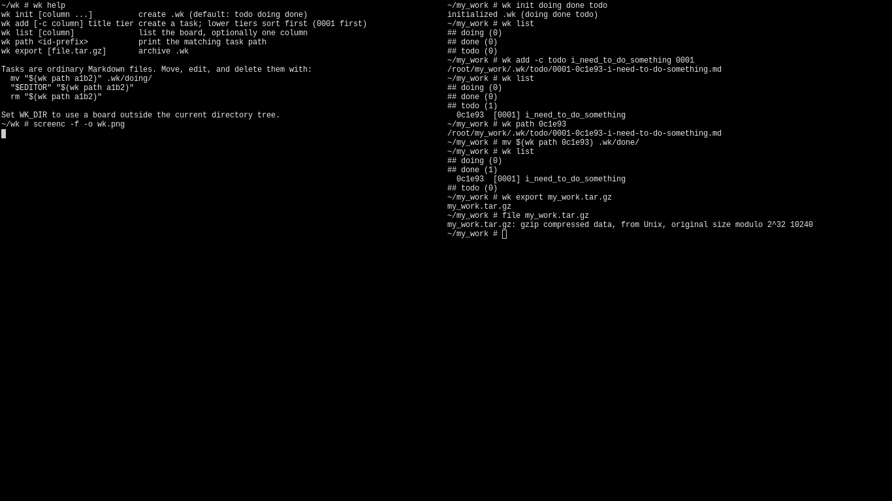

# wk (workkan) - file-based kanban



`wk` is a tiny kanban board backed by directories and Markdown files. Columns are
folders; tasks are files. There is no database, daemon, or custom task editor.
Use `mv`, your `$EDITOR`, and `rm` to manage tasks.

## Install

```sh
make install
```

The default install location is `/usr/local/bin`. Override it with `PREFIX`, or
use `DESTDIR` when packaging:

```sh
make install PREFIX="$HOME/.local"
```

To check the script without installing it:

```sh
make check
```

## Start a board

Run this in the project directory:

```sh
wk init
```

This creates `.wk/` with three columns: `todo`, `doing`, and `done`. You can
choose your own columns instead:

```sh
wk init backlog ready doing done
```

Column order is the order given to `wk init` and shown by `wk list`.

## Add tasks and set their order

Give each task a title followed by a numeric tier:

```sh
wk add "Plan the release" 0001
wk add "Write the changelog" 0002
wk add "Check translations" 0010
wk add -c doing "Fix the parser" 0003
```

The tier is an ordering value, **not** the task ID. Lower values appear first;
`0001` comes before `0002`. Tiers may be written with one to four digits and
are stored as four digits (so `2` becomes `0002`). Tasks with the same tier are
ordered by their randomly generated IDs.

Each task is stored as a file named like:

```text
.wk/todo/0001-a1b2c3-plan-the-release.md
```

The six-character hexadecimal ID is random. The file's first line is its title;
the file is otherwise ordinary Markdown and can contain whatever notes you need.

## View and manage the board

```sh
wk list             # all columns
wk list todo        # one column
wk path a1b2        # resolve a unique ID prefix to a file path
```

Use normal Unix tools to edit the board:

```sh
mv "$(wk path a1b2)" .wk/doing/
"${EDITOR:-vi}" "$(wk path a1b2)"
rm "$(wk path a1b2)"
```

Moving a task file to another column changes its status. Its tier and ID stay
in the filename, so its ordering is preserved.

## Export

Create a compressed backup of the board:

```sh
wk export
wk export backup.tar.gz
```

## Board location

`wk` searches the current directory and its parents for `.wk/`. To use a board
at another location, set `WK_DIR` to the `.wk` directory:

```sh
WK_DIR="$HOME/boards/work/.wk" wk list
```

## License

BSD 3-Clause. See [LICENSE](LICENSE).
